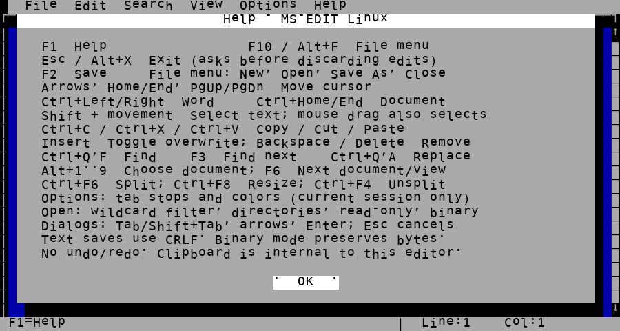
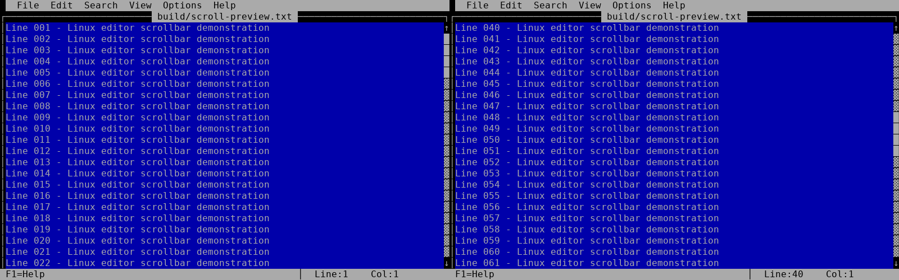

# MS-EDIT Linux (AI PROJECT)

A Linux terminal text editor inspired by **MS-DOS Editor 2.0.026**.

Version **0.5**, prepared on 20 October 2026, based on the published 0.4 release. It retains the original editor's menus, mouse selection, multiple documents and split windows. The implementation is new and written in C; it is neither Microsoft's original source code nor a complete decompilation or exact clone of the original program.

## Building and running

Requirements:

- Linux
- A C compiler (GCC or Clang)
- GNU Make
- An ANSI/xterm-compatible terminal

No ncurses, external libraries, DOS compilers, emulators or help files are required.

Minimum terminal size: **75×24**.

```sh
make
./editr DEMOES.TXT
```

`make` builds the `editr` executable in the project root. Python 3 is only required for interface tests, not for building or running the editor.

```sh
make test
make clean
make CC=clang
```

The Makefile uses strict C89 and treats warnings as errors by default. You can override the compiler flags with:

```sh
make CFLAGS='-std=c89 -Wall -Wextra -O2'
```

## Usage and keyboard shortcuts

Press **F1** to open the integrated help. It is also available through Help → Commands and the file selector.

When editing, **Escape** behaves like Alt+X and initiates the normal exit procedure. If there are unsaved changes, the editor asks whether to save, discard or cancel. Inside a menu or dialog, Escape closes or cancels that interface and returns to the editor.

| Action | Key or menu |
|---|---|
| Help | F1 |
| Menus | F10; Alt+F/E/S/V/O/H |
| Save | F2; File → Save |
| New, open, save as, close | File menu |
| Exit | Escape; Alt+X |
| Select text | Shift + movement; mouse dragging |
| Copy, cut, paste | Ctrl+C, Ctrl+X, Ctrl+V |
| Find | Ctrl+Q, then F; Search → Find |
| Find next | F3 |
| Replace | Ctrl+Q, then A; Search → Replace |
| Switch to document by number | Alt+1…9 |
| Next document or view | F6 |
| Split / resize / close split | Ctrl+F6 / Ctrl+F8 / Ctrl+F4 |
| Move by words / document start and end | Ctrl+Left/Right / Ctrl+Home/End |
| Insert / overwrite mode | Insert |
| Navigate dialogs | Tab, Shift+Tab, arrow keys; Enter to confirm |

The clipboard is internal to the editor. Terminal pasting supports *bracketed paste*, while Ctrl+V pastes text copied within the editor. Some terminal environments intercept keyboard shortcuts before they reach the application.

### Command-line options

```sh
./editr --help
./editr -R file.txt             # Read-only
./editr -R one.txt -W two.txt   # Options apply to subsequent files
./editr -70 data.bin            # Binary view, 70 bytes per row
./editr -16 data.bin -0 notes.txt
./editr -B notes.txt            # Monochrome
./editr -- -filename-with-dash.txt
./editr '*.txt'                 # Wildcard interpreted by the editor
```

Supported options begin with `-`:

- `-B`: monochrome mode
- `-R`: read-only mode
- `-W`: writable mode
- `-<width>`: binary view width
- `-0`: text mode
- `-h`, `--help`: command-line help
- `--`: terminates option processing

Paths beginning with `/` are always treated as Linux paths.

The DOS-specific `/H` (DOS rows) and `/S` (short filenames) options have been removed because they have no useful equivalent in Linux.

Binary view widths are limited to 1021 bytes. Very large numeric arguments are no longer silently truncated to 16 bits. File filters retain their case-insensitive ASCII comparison and the historical `*.*` behaviour, which also matches filenames without extensions.

## Behaviour and known limitations

- **Text-mode saving converts CRLF to LF and keeps existing LF.** Enter inserts LF. Non-empty documents without a final LF still get one on save; empty documents remain empty. Standalone CR bytes are preserved as data. Binary mode preserves every byte without conversion. See [exact save rules](docs/buffer.md#loading-and-saving).
- **Vertical scrollbars show the visible fraction and position** using Unicode `█` (CP437 219) over `▓` (CP437 178). Drag the thumb, click the track or use its arrows. Scrolling places the cursor at the first visible line and clears the selection, matching the previous scrollbar click behavior.
- Up to nine documents can be open simultaneously, with a maximum size of 16 MiB per document. File paths are limited to 259 bytes. Undo and redo are not implemented.
- UTF-8 and Spanish characters are supported, with CP437 conversion for files that are not valid UTF-8. Full support for grapheme clusters, combining characters, emoji and every terminal display width is not guaranteed. Case-insensitive searching does not implement all Unicode cases.
- Tab width and colours are configurable for the current session, but settings are not saved between sessions. Printing remains disabled.
- Documents larger than 96 KiB use temporary storage in `TEMP`, then `TMP`, or the current directory as a fallback. Temporary files may grow as edits accumulate and are not compacted during the session. There is no automatic recovery after a forced termination.
- Saving prepares a temporary file and a backup in the destination directory. Write, close and rename errors are checked, and pending changes are preserved if saving fails. The implementation does not guarantee durability against power loss, preservation of all file metadata or coordination with simultaneous writers.

## Origin and research

The project began with an experiment proposed by **Raúl Sanguiao (velorek1)**, who supplied `edit.dec`: a text representation of the original executable's bytes, encoded as signed decimal integers separated by dots.

**Javier Sanguiao** coordinated the development process, working with the AI coding assistant Kai to investigate the original executable, explore its internal structures and progressively reconstruct its functionality.

Analysis of the executable and findings from earlier development stages provided the reference for the new implementation.

The preserved research established the following:

1. Validating the range −128…127 and applying `value & 0xff` reconstructs a 69,886-byte MZ executable. Its SHA-256 is `68047c8ede4ee93cf704bdcc5d97caa3d5a5a787726d87cb39d4db9f25fa67a8`.
2. The resources identify MS-DOS Editor 2.0.026, copyright Microsoft 1995, and a Microsoft runtime from 1992. They do not establish the exact compiler version. Borland C++ 3.1 was a target for the earlier DOS reconstruction, not a verified compiler for the original.
3. EXEPACK decompression produces a 62,480-byte image containing 40 blocks and 14 relocations, with a relative entry point of `0000:0718`. Historical validation executed the original stub using Unicorn at three load addresses and compared the resulting image against an independent Python decompressor. Verifying the stub does not amount to verifying the entire editor.
4. A total of 248 resources were identified. Their offsets are relative to individual resource-table entries rather than a shared base address. Menus, strings and controls helped establish the original program's interface and functionality.
5. The startup code and a candidate `main` routine were examined using decompiled pseudocode. Inferred function names remain hypotheses; the original algorithms and symbols were not fully recovered.

A summary of the historical research is available in [docs/ORIGIN.md](docs/ORIGIN.md).

This Linux release does not include Microsoft's original executable, `edit.dec`, DOS images, legacy compilers or machine-code dumps. Building and testing the new editor does not require any of these reference materials.

## Technical design

The editor core uses a **gap buffer** for smaller documents. Larger documents combine temporary-file storage, a fragment list and a 4 KiB cache. These are new implementation choices, not structures demonstrated to exist in the original editor.

Multiple views can share the same document while maintaining independent cursor positions and scroll offsets.

The Linux backend uses `termios`, keyboard and mouse pseudo-events, and ANSI terminal sequences. It redraws changed cells and adapts to the terminal's current dimensions. CP437 support is retained for legacy characters and the original interface's visual style.

Version 0.4 removes `dos.c`, Borland-specific code paths, `huge` pointers, DOS directory and drive APIs, BAT scripts and DOS build tools.

The help system is now embedded directly in the C source code and no longer looks for `EDIT.HLP`. Escape-based exit reuses the same exit and confirmation logic as Alt+X, avoiding duplicated save-handling code.

For a guided explanation of every source and header file, including functions,
data flow and design choices, start with [Learning the source](docs/README.md).

### Source code organisation

| File | Responsibility |
|---|---|
| `src/buffer.c` | Document model, storage, searching and I/O |
| `src/editor.c` | Interaction, menus, help, documents and views |
| `src/host.c` | Linux terminal, input, mouse and rendering |
| `src/files.c` | Paths, directory enumeration and filters |
| `src/cli.c` | Command-line arguments |
| `src/utf8.c` | Character decoding and conversion |
| `tests/` | C tests and real interface tests using a pseudo-terminal |



The historical screenshot predates the LF save policy in 0.5.



## Authorship and credits

The new C implementation, analysis tools, tests and documentation were developed with the assistance of **Kai**, an OpenAI AI coding assistant, working under instructions from Javier Sanguiao and incorporating ideas, feedback and testing from Raúl Sanguiao.

The Linux port and release preparation were also carried out with AI assistance through Codex.

Raúl initiated the experiment, provided the original executable reference and contributed feedback that helped shape the editor's behaviour and interface. Javier coordinated the development and research process.

The project is a new implementation inspired by MS-DOS Editor 2.0.026. It is not Microsoft's original source code, nor a complete decompilation of the original program.

Raúl's separate C-EDIT project is independent of this repository. This release derives from MS-EDIT 0.3.1, not from modifications to C-EDIT.

Microsoft retains the rights to its original software. This project is neither sponsored nor endorsed by Microsoft. See [NOTICE.txt](NOTICE.txt).

The published repository includes an [MIT license](LICENSE), copyright 2026 Raúl Sanguiao.

## Validation

Version 0.5 was compiled with GCC 13.3.0 on Linux using strict C89 and the following flags:

`-pedantic -Wall -Wextra -Werror -O2`

All **five C test executables** and **31 Python interface tests** pass.

The tests cover:

- 8,000 random editing operations
- 1 MiB documents
- I/O failure handling
- Spanish UTF-8 text
- Searching and replacing
- Text selection
- Multiple views
- Mouse interaction, proportional scrollbar dragging, release and endpoints
- Terminal resizing
- Integrated help
- Escape-based exit with save, cancel and discard options

Further details and testing limitations are documented in [docs/TESTING.md](docs/TESTING.md).

Compatibility with every terminal emulator and complete equivalence with MS-DOS Editor are not claimed.
